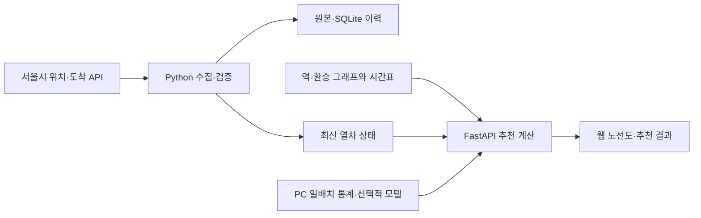

# 목표 도착 시각 기반 지하철 출발 추천 — 2명·4주 실행 계획

작성일: 2026-11-16. 개발 기간: 11월 16일~12월 13일, 평일 개발 20일 기준.
인원: 2명. Kafka·Flink·Spark는 과제 필수 조건이 아님.

## 1. 4주 뒤 완성할 서비스

사용자가 출발역·도착역·목표 도착 날짜와 시각을 입력하면, 현재 탈 수 있는 열차와 환승 연결을 계산해 **목표 시각까지 도착 가능한 가장 늦은 승차 시각과 여유 있는 권장 승차 시각**을 제공한다.

예시 화면 문구는 다음과 같다. 시간은 기능 설명을 위한 가상 예시다.

> 사당 → 혜화 / 오늘 09:00까지 도착
>
> 권장: 08:13 열차 / 예상 도착 08:48
>
> 가장 늦은 후보: 08:20 열차 / 예상 도착 08:55 / 도착 여유 5분
>
> 출발역 승강장에 표시 시각 이전까지 도착하세요.
>
> 정보 갱신 08:08:15 / 실시간 보정 적용

출발 시각은 우선 **출발역 승강장에서 승차할 시각**으로 정의한다. 역 입구부터의 이동시간을 설정하면 역 입구 도착 권장 시각도 함께 표시할 수 있다. 집에서 출발할 시각은 집→역 도보 입력이 있어야 계산할 수 있으므로 기본 결과와 구분한다.

첫 버전의 권장 범위:

- 경로 계산·도착 추천: 2호선 본선과 4호선 중 시간표·실시간 매칭이 검증된 구간부터 시작한다. 역 목록은 1주차에 고정한다. 2호선 지선, 급행, 서비스 범위 밖 운영 구간은 별도 검증 전까지 제외한다.
- 환승은 최대 1회. 사당·동대문역사문화공원 등 실제 연결점과 환승 방향을 검증한다.
- 서비스 대상은 우선 평일 출퇴근 시간. 그 밖의 시각에는 시간표 기반 추정으로 명시하거나 추천 범위를 제한한다.
- 실시간 추천은 현재부터 약 60~90분 이내를 우선 지원한다. 그보다 먼 시각은 시간표·과거 통계로 계산하고 실시간 모드와 구분한다.
- 노선도, 출발·도착 검색, 목표 도착 시각, 추천 카드, 경로 강조, 마지막 갱신 시각을 필수로 만든다.
- 1~8호선 추천 확대, 2회 이상 환승, 경유역, 로그인, 자연어 챗봇, 개인화, 탑승 실패 확률은 후순위다.

범위가 줄어드는 이유는 UI 크기보다 열차·방향·종착역·운영 구간의 정합성 검증에 시간이 필요하기 때문이다. 첫 범위가 안정된 뒤 같은 데이터 구조로 노선을 늘린다.

## 2. 현재 확보한 것과 바로 보완할 것

2026-11-16 오후 EC2의 SQLite를 읽기 전용으로 조회한 결과다. 이후 수집으로 건수는 늘어날 수 있다.

| 항목 | 확인 결과 | 계획에 미치는 영향 |
|---|---|---|
| 위치 데이터 | 11/12 199,802건, 11/13 392,320건, 11/16 193,745건; 합계 785,867건 | 행 수는 많지만 관측일은 3일이다. 요일별 일반화를 주장하기에는 부족하다. |
| 시간표 매칭 지연 | `matched_observation_interval` 99,493건 | 지연 통계와 기준선 제작에 쓸 수 있다. 실제 물리적 도착시각의 정밀한 정답은 아니다. |
| 정적 파일 적재 | `reference_files` 비어 있음 | 역 목록·연결·역간시간·환승시간을 먼저 확보해야 한다. |
| 승하차 통계 적재 | `boarding_volume` 비어 있음 | 모델 필수 입력으로 잡지 않는다. |
| 수집 설정 | 1~8호선, 평일 06:30~09:30·17:30~20:30, 위치 15초, 도착 샘플 120초 | 낮·주말 실시간 안내를 현재 수집기만으로 제공할 수 없다. |
| API·웹·학습 모델 | 저장소 문서상 후속 구현 | 1주차부터 웹과 API를 연결해야 한다. |
| 서버 | t3.micro, 메모리 약 1GB; 조회 당시 SQLite 약 1.8GB | 학습은 개발 PC에서 하고 수집 서버에 무거운 분산처리 도구를 함께 올리지 않는다. |

문서 일부에는 주말 수집·30초 주기가 남아 있지만, 위 표는 EC2 실제 설정을 기준으로 한다.

## 3. 계산과 예측 모델의 역할

**모델이 없어도 1차 서비스는 가능하다.** 시간표, 현재 열차 정보, 역간 소요시간과 환승시간으로 추천을 만들고, 수집 이력은 오차 보정과 모델 검증에 사용한다.

| 질문 | 먼저 사용할 방법 | 모델이 개선할 부분 |
|---|---|---|
| 열차가 지금 어디에 있는가 | 신선한 위치 API와 열차 상태 | 모델 없이 표시 가능 |
| 출발역에 언제 오는가 | 도착 API의 예정시간과 생성시각, 위치·시간표 교차 확인 | API 오차나 미제공 구간의 남은 시간 보정 |
| 이 열차로 목적지에 언제 도착하는가 | 예정 도착·역간시간·현재 지연으로 남은 구간 계산 | 지연이 이후에 회복·확대되는 양상 |
| 환승 열차를 탈 수 있는가 | 첫 열차 도착 + 방향별 환승시간 + 승차 여유와 다음 열차 출발을 비교 | 시간 오차가 연결에 미치는 영향 |
| 목표 시각을 맞추려면 언제 타야 하는가 | 후보 열차별 전체 경로를 평가하고 가장 늦은 유효 후보 선택 | 경로 전체 도착 오차와 여유시간 산정 |

도착 API의 `barvlDt`는 도착예정시간(초), `recptnDt`는 도착정보 생성시각이다. 첫 구현은 `생성시각 + 남은 초`를 ETA 후보로 만들되, 실제 응답의 갱신 특성을 관측 도착과 대조해 기준시각 해석을 검증한다. 오래된 응답, 0 값, 이미 출발 상태, 방향·종착역 불일치는 별도 처리한다.

**도착 API의 ETA에 현재 지연을 다시 더하지 않는다.** 이미 운행상황을 반영한 추정치일 수 있다. 시간표로 미래 구간을 계산할 때의 지연 보정과, API ETA를 쓰는 경우의 추가 보정은 분리한다.

기본 계산 절차:

1. 서버의 현재 KST, 목표 날짜·시각, 데이터 생성·수집시각을 함께 확정한다.
2. 출발역→도착역의 유효한 경로 후보를 2~3개 만든다. 역 이름만 쓰지 않고 역·노선·방향을 구분한다.
3. 경로마다 현재 이후 승차 가능한 실제 열차 후보를 찾는다. 종착역·정차역·분기·이미 지나간 열차를 확인한다.
4. 첫 승차 대기와 남은 구간을 계산한다. 미래 구간의 지연이 모두 동일하다는 가정은 초기 기준선으로만 사용한다.
5. 환승역 예상 도착 + 환승 이동시간 + 승차 여유보다 늦게 출발하는 연결 열차를 선택한다. 놓치면 다음 열차로 다시 계산한다.
6. 목적지 도착이 목표 이하인 후보를 모아 가장 늦게 출발하는 후보와 여유를 둔 후보를 선택한다.
7. 유효 후보가 없으면 불가능 또는 다음 가능한 도착시각을 반환한다. 과거 출발시각을 추천하지 않는다.
8. 새 정보가 오면 같은 선택 조건으로 재계산한다. 추천 열차가 바뀐 이유와 갱신 시각을 표시한다.

목표 시각에서 평균 이동시간 하나를 빼는 방식으로 끝내지 않는다. 열차 배차와 환승 연결 때문에 시간표에 맞는 열차 후보를 실제로 검증해야 한다.

## 4. 실시간 처리의 최소 구조

- 프런트는 팀이 익숙한 프레임워크를 사용한다. 미정이면 React와 TypeScript, 노선도는 직접 관리하는 SVG로 시작한다.
- 백엔드는 기존 Python 수집 코드를 재사용할 수 있는 FastAPI를 권장한다.
- 현재 SQLite는 수집 이력을 보존한다. 웹 요청마다 대용량 이력을 집계하지 않고 최신 상태와 사전 계산 통계를 읽는다.
- 최신 상태는 첫 주 파일의 원자적 교체 또는 작은 상태 저장소로 전달할 수 있다. 여러 프로세스가 공유해야 하거나 병목이 확인되면 Redis로 교체한다.
- 수집 주기는 위치 15초를 출발점으로 삼는다. 웹 갱신은 처음 15~30초 polling으로 구현하고 필요하면 SSE로 바꾼다. 외부 원천보다 자주 화면을 갱신해도 새 실측값이 생기지는 않는다.
- 유저마다 외부 API를 호출하지 않는다. 중앙 수집·캐시를 공유하고 예산을 합산한다.
- 학습·무거운 집계는 개발 PC에서 수행하고 배포 서버에는 통계·작은 모델 결과만 배포한다. API 서버의 분리가 필요하면 수집 데이터 복사·상태 전달부터 정리한다.
- Kafka·Flink·Spark·Airflow가 실시간 추천의 필수 조건은 아니다. 2명·4주에서는 기본 일정에 넣지 않는다.

현재 8개 노선 위치 수집만으로 `8 × 6시간 × 240회 = 11,520회/일`이므로, 낮 시간 확대나 도착정보 갱신 가속은 실제 API 한도와 공통 호출 예산을 계산한 뒤 결정한다. 120초 도착 샘플 수집을 서비스 수준 ETA로 쓰려면 신선도를 검증하고 선택 구간의 갱신을 보강해야 한다.

초기 상태 유효기간은 예를 들어 90초로 두고 실제 데이터에서 조정한다. 오래되면 움직임을 계속 표시하는 대신 시간표 추정으로 전환한다. 열차 위치 애니메이션의 보간은 시각 표현이며 실측 GPS 위치로 부르지 않는다.

API 계약 초안:

| API | 주요 반환값 |
|---|---|
| `GET /stations` | 공통 역 ID, 노선, 검색명, 지원 여부 |
| `GET /network` | 노선도 좌표, 노선 연결, 환승 연결, 지원 구간 |
| `GET /trains?line_id=...` | 열차·방향·종착역·상태·원천시각·신선도 |
| `POST /recommendations` | 출발·도착·목표시각에 대한 권장/가장 늦은 승차 후보와 경로 |
| `GET /health` | 수집·API 상태, 마지막 갱신, 통계·모델 버전 |

추천 응답에는 `as_of`, `data_mode`, `board_at`, `estimated_arrival`, `deadline_slack_seconds`, `legs`, `warnings`를 포함한다. 시간 범위·확률은 검증된 경우에만 추가하고, 초기 고정 여유는 가정임을 구분한다.

## 5. 두 사람의 담당과 의존 관계

| 담당 | 책임 | 매주 함께 확인할 것 |
|---|---|---|
| A: 프런트·사용자 흐름 | 노선도, 역 검색, 목표 시각 입력, 추천 카드, API 연동, 반응형, 사용성 테스트 | 같은 역/노선 ID, 날짜와 시각 해석, 오래된 정보 표시 |
| B: 백엔드·데이터 | 정적 데이터 정리, 그래프·열차 연결, 실시간 상태, 추천 엔진, 통계·선택적 ML, 운영 | 경로 정답 사례, 외부 API 예산, 장애 시 응답 |

A는 목업 JSON으로 1일차부터 화면을 시작한다. B의 계산 엔진 완료를 기다리지 않는다. A는 2주차 이후 경로 사례 작성·리플레이 검증도 분담해 B에게 모든 검증이 몰리지 않게 한다.

매일 15분 동안 전날 동작 화면, 막힌 데이터, 당일 연결할 API를 확인한다. 매주 금요일 실제 또는 명시적인 과거 재생 데이터로 시연한다.

## 6. 20일 개발 일정

| 주·날짜 | A: 프런트·검증 | B: 백엔드·데이터 | 당일 완료 기준 |
|---|---|---|---|
| 1주 월 11/16 | 출발/도착/목표시각/결과 화면 초안 | 지원 노선·역·시간대 확정, 데이터 품질 점검 | 서비스 범위와 API 입출력 예시 합의 |
| 화 11/17 | 역 검색·선택, 목업 추천 카드 | 역 목록·역간시간·환승시간 적재, 공통 ID 매핑 | 동일 역을 웹과 API가 같은 ID로 사용 |
| 수 11/18 | 2개 노선 SVG, 확대·이동 | 방향별 역 그래프, 시간표 경로 계산 | 직통 경로와 환승 1회 경로가 계산됨 |
| 목 11/19 | 선택·해제·교환, 경로 강조 | 목표시각 기반 후보 열차 선택, 추천 API 초안 | 시간표 기준 가장 늦은 승차 후보 반환 |
| 금 11/20 | 실제 API 연결, 오류·빈 결과 화면 | 시간표·경로 사례 테스트, 개발 서버 배포 | 웹에서 목표시각 입력→추천 결과까지 동작 |
| 2주 월 11/23 | 열차 상태·갱신 시각 표시 | 최신 위치 상태, 유효기간·중복·역전 처리 | 신선한 상태와 오래된 상태가 구분됨 |
| 화 11/24 | 노선도 열차 표시·방향 안내 | 도착 API 연동, 열차번호·방향·종착역 결합 | 출발역 다음 열차 ETA를 실시간으로 반환 |
| 수 11/25 | 환승 순서·구간별 안내 | 환승 이동시간과 다음 열차 연결 계산 | 환승 놓침을 다음 열차로 재계산 |
| 목 11/26 | 추천 카드 자동 갱신·변경 안내 | 실시간 지연 보정, 가장 늦은 후보/권장 후보 분리 | 데이터 변화에 따라 추천이 바뀜 |
| 금 11/27 | 직통·환승·불가능 시연 | 오류·지연·누락 리플레이 검증 | 실시간 추천 MVP 완성. 이후 범위 동결 |
| 3주 월 11/30 | 결과 설명·도착 여유 표시 | 시간표·지연 유지·통계 기준선 비교 | 모델 이전 기준선 성능표 확보 |
| 화 12/01 | 리플레이 UI 또는 시연 모드 | 시간 기준 학습 표본과 도착 관측 구간 생성 | 예측 시점 이후 정보가 특성에 섞이지 않음 |
| 수 12/02 | 날짜·시간대·지원 범위 안내 | 작은 LightGBM 회귀/분위 모델 실험 | 동일 검증 날짜에서 기준선과 비교 |
| 목 12/03 | 가독성·모바일 개선 | 기준선/모델 중 채택, 부족 구간 fallback | 개선 없으면 기준선을 유지하고 이유 기록 |
| 금 12/04 | E2E 테스트와 시연 흐름 고정 | API 통합, 예측 오차·경로 추천 평가 준비 | 배포 후보 버전. 새 기능 추가 중단 |
| 4주 월 12/07 | 지연·누락·잘못된 입력 테스트 | 날짜 분리 최종 평가 시작, API 장애 대응 | 늦은 출발·미지원 구간을 안전하게 처리 |
| 화 12/08 | 테스트 사용자 피드백 반영 | 캐시·응답시간·로그·백업 점검 | 합의한 동시사용 시나리오에서 운영 가능 |
| 수 12/09 | 작은 화면·선택 상태·접근성 | 재시작 복구, 호출량·디스크 점검 | 재시작 후 데이터·현재 상태 복구 |
| 목 12/10 | 발표 화면·시연 영상 | 평가표·데이터 출처·운영 가이드 | 라이브/리플레이 시연 모두 준비 |
| 금 12/11 | 최종 리허설·치명 오류 수정 | 최종 배포·체크리스트 | 공개 데모 가능한 완성본과 재현 문서 |

12/12~13은 일정 여유로 남긴다. 평일 내 마무리를 원칙으로 하고 모델 추가나 노선 대폭 확대에 쓰지 않는다.

## 7. 선택적 예측 모델: 한 가지 문제에 집중

목표는 **현재 시점에 이 열차가 특정 하류 역까지 가는 데 남은 시간**이다. 처음부터 경로·환승·혼잡 모델을 각각 학습하지 않는다.

- 입력: 노선·방향·현재 역/상태·예측 대상 역까지 정차 수·종착역·시각·출퇴근 구간·현재까지 관측된 지연·최근 구간 소요시간·데이터 나이.
- 요일은 장기적으로 쓸 수 있지만 3개 수집일만으로 요일별 패턴이 검증됐다고 보지 않는다.
- 타깃: 예측 시점 이후 대상 역 도착까지의 남은 초. `delays.delay_seconds`를 그대로 정밀한 미래 정답으로 취급하지 않는다.
- 도착은 구간 관측이므로 타깃의 하한·상한을 보존한다. 중간값 또는 보수적 상한으로 학습할 경우 선택을 문서화하고 양쪽 기준 민감도를 함께 확인한다.
- 유효 관측이 없는 예, 매칭 모호성, 대규모 관측 공백은 필터링하거나 별도 평가한다. 미매칭 지연을 0으로 채우지 않는다.
- 기준선: 시간표 그대로 / 현재 지연 유지 / 구간·시간대별 과거 중앙값.
- 모델: LightGBM 작은 회귀 모델부터 시작하고, 표본이 충분하면 P50/P95 분위 회귀를 비교한다.
- 날짜순 분할을 사용한다. 같은 운행일의 열차 궤적에서 잘라낸 인접 표본을 학습·테스트에 나누지 않는다. 3주차까지의 과거 일자로 학습·검증하고, 4주차 새 일자는 최종 평가로 남긴다.
- 특징 집계와 역간 통계도 예측 시점 이전에 사용 가능했던 값으로 만든다. 미래 원천 관측뿐 아니라 늦게 수신한 과거 관측도 당시 수신 여부를 따진다.
- 실시간 도착 API를 추천에 썼다면 평가에서도 해당 API 기준선을 포함해 추가 모델의 이득을 확인한다. 출발역 도착 ETA와 더 먼 하류 역 도착 예측은 같은 지평끼리 비교한다.

P95는 추정한 95번째 백분위수다. 검증 없는 "95% 도착 보장" 표현을 쓰지 않는다. 구간별 P95의 합도 경로 전체의 P95가 아니다. 환승을 포함한 전체 경로를 리플레이해 목표시각 내 도착률과 출발 여유시간을 함께 측정한다. 표본이 부족하면 단순 여유시간을 쓰고 그 가정을 표시한다.

## 8. UI를 만드는 순서

1. **입력과 결과 카드:** 출발역, 도착역, 목표 도착 날짜·시각, 검색 버튼. 노선도 없이도 추천 흐름부터 연결한다.
2. **역 검색:** 자동완성, 출발/도착 교환, 선택 취소. 노선도를 정확히 누르기 어려운 사용자도 이용할 수 있게 한다.
3. **간단한 SVG 노선도:** 지원 노선·역·환승점. 위경도는 역 식별에 쓰고 화면 배치용 x/y는 별도로 관리한다. 실제 좌표를 그대로 그리면 역 이름이 겹칠 수 있다.
4. **경로 강조:** 선택한 경로를 강조하고 나머지는 흐리게 표시한다. 환승점과 진행 방향을 구분한다.
5. **실시간 열차:** 선택 경로와 관련된 열차부터 표시한다. 종착역·진행 방향·최근 갱신을 확인할 수 있게 한다.
6. **추천 상세:** 권장/가장 늦은 후보, 열차와 방향, 승차 시각, 예상 도착, 환승 순서, 도착 여유, 정보 기준시각.
7. **예외 상태:** 기한 경과, 불가능한 도착, 미지원 역/시간대, 데이터 오래됨, API 실패, 시간표 추정, 과거 재생을 각각 표시한다.

라이브와 리플레이는 화면 상단에서 구분한다. 목표시각에 맞추기 위해 과거 데이터를 현재 운행처럼 표시하지 않는다.

## 9. 완료 판정과 범위 축소 기준

필수 완료 기준:

- 브라우저에서 출발·도착·목표시각 입력부터 결과까지 한 번에 동작한다.
- 직통과 환승 1회 사례에서 열차 방향·종착역·승차 가능성·목표시각을 검증한다.
- 도착기한 경과·추천 불가·시간표 부재·실시간 만료·API 오류를 처리한다.
- 추천마다 정보 기준시각과 계산 모드를 표시한다.
- 같은 과거 시점으로 재생하면 당시까지 수신된 데이터만으로 결과를 재현한다.
- ETA 오차, 경로 전체 목표시각 내 도착률, 너무 이른 출발 여유, 적용 가능 비율과 표본 수를 함께 보고한다.
- 관측만으로 판정할 수 없는 경계 사례는 성공/실패로 단정하지 않고 구분한다. 실제 승객 탑승·환승 성공을 관측한 결과와 시뮬레이션 평가는 구별한다.
- 예를 들어 동시 사용자 10명과 캐시가 준비된 요청의 p95 응답 2초 이내를 개발 목표로 두고 실제 서버에서 측정한다. 보장된 현재 성능으로 표현하지 않는다.
- 수집기 재시작, 백업 복원, API 키 미노출, 공통 호출 예산, 디스크 증가를 점검한다.

범위 축소 결정:

- 1주차에 역·시간표 매핑이 막히면 단일 노선 직통부터 완성하고 환승을 다음 단계로 미룬다.
- 2주차에 실시간 추천이 안 되면 3주차 모델 실험을 취소하고 추천 엔진에 집중한다.
- 3주차 모델이 기준선보다 좋아지지 않으면 통계 기준선으로 배포한다. 비교 결과는 프로젝트 성과로 남긴다.
- 4주차에는 새로운 노선·Kafka·새 모델을 추가하지 않는다.
- 혼잡도 통계만으로 실제 탑승 실패 확률이나 보내야 할 열차 수를 만들지 않는다. 별도 실측이 없으면 일반 혼잡 안내 또는 사용자 선택 여유만 제공한다.

## 10. 바로 시작할 첫 세 작업

1. 출발 시각의 의미, 지원 노선·역·시간대, 최대 환승 횟수와 목표시간 입력 범위를 두 사람이 확정한다.
2. B는 정적 데이터 3종(역/연결, 역간시간, 환승시간)을 확보해 공통 역 ID와 시간표 매핑을 만든다.
3. A는 같은 역 ID를 쓰는 목업 JSON으로 입력→추천 카드 흐름을 구현한다. 첫 주 금요일에 시간표 기반 API와 연결한다.

## 참고 근거

- 현재 구현: `src/subway_collect/storage.py`, `derive.py`, `cli.py`, `reference.py`, `config/collector.json`, `sql/schema.sql`.
- 서비스 의도와 관측 한계: `docs/requirements.md`, `docs/data-contract.md`.
- [서울시 실시간 도착정보 API 명세](https://data.seoul.go.kr/dataList/openApiView.do?infId=OA-12764&srvType=A): 도착예정시간, 정보 생성시각, 열차번호, 방향, 종착역과 상태.
- [서울시 실시간 열차 위치정보](https://data.seoul.go.kr/dataList/OA-12601/A/1/datasetView.do): 위치 조회와 과거 실시간 데이터 소급 제공의 제약.
- [LightGBM 공식 파라미터 문서](https://lightgbm.readthedocs.io/en/stable/Parameters.html): quantile objective와 alpha.
- [FastAPI 배포 개념](https://fastapi.tiangolo.com/deployment/concepts/): 프로세스·메모리·운영 고려사항.
